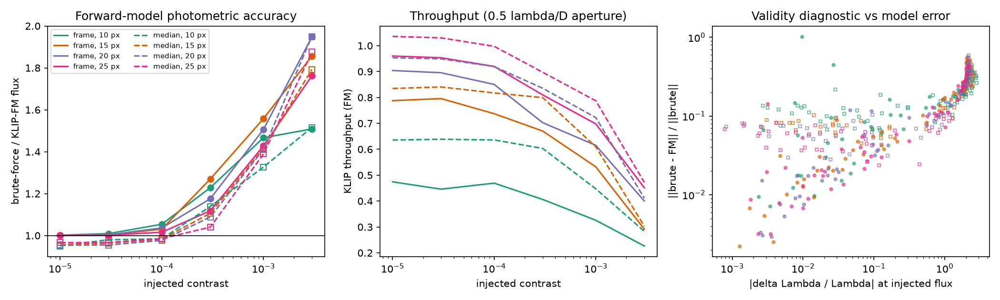
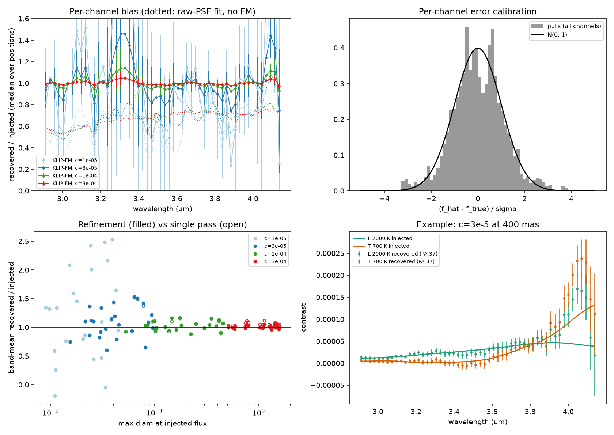
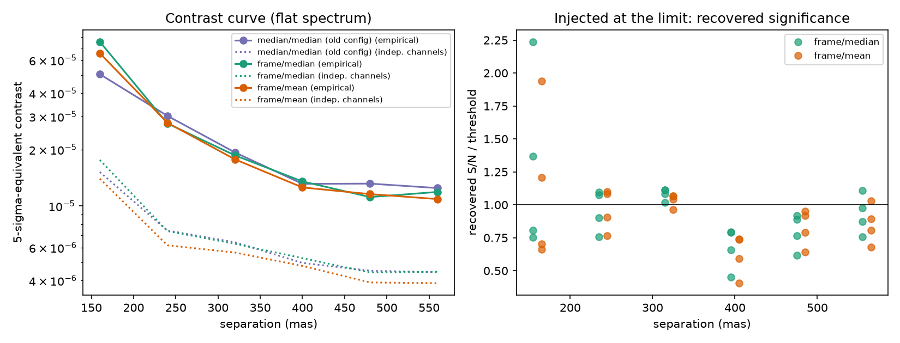
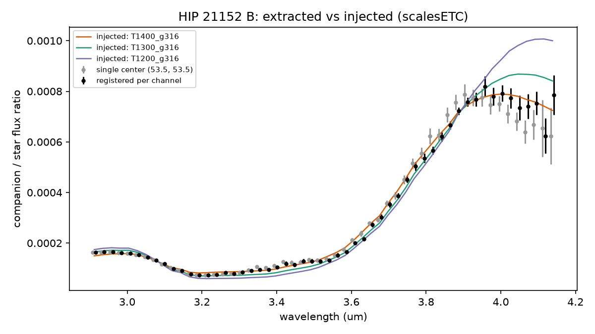

# Validation of `jighcontrast.jFM`

Two layers of tests back the KLIP forward-modeling code:

* **Unit tests** (`../tests`, `pytest`, ~30 s) on small synthetic ADI + IFS data
  sets: the first-order perturbation of the KL basis against finite differences
  (Pueyo 2016, Eq. 51), the single-frame forward model against brute-force KLIP,
  sub-pixel registration of rotation/derotation, spectral recovery, error-bar
  calibration, bright-source refinement, matched-filter template registration
  in `contrast_curve`, the empirical channel combination, and the `jEvol`
  out-of-grid behavior.
* **Injection-recovery studies** (this directory) on a realistic data set: a
  scalesETC simulation of a 3 h SCALES L-band (2.9-4.1 um, 54 channels) ADI
  sequence of HIP 21152, 90 exposures over 108 deg of sky rotation, with the
  companion HIP 21152 B injected by the simulator at 390 mas.

All numbers below come from the scripts here; the figures are in `results/`.

## Data preparation

* **In the simulation the star moves with wavelength.** Measured on the
  unocculted sequence it drifts from (54.01, 53.85) at 2.91 um to (54.49, 54.80)
  at 4.14 um (pixels), constant in time. This is an artifact of the simulator,
  not atmospheric dispersion (scalesETC does not apply its dispersion model):
  it rescales its PSF with wavelength about the array edge rather than the PSF
  center, and its spectrograph projection/extraction adds ~0.2 pixel more. The
  companion and the unocculted star share the same PSFs, so the companion
  rotates about the star's position in each channel. To test the method rather
  than this artifact, the injection tests register every channel on the star
  (`jPhot.measure_star_centers`, `jPhot.register_channels`). This is not the
  procedure for real data -- see "Star position in real data" below.
* **The simulation's companion is removed** for the injection tests
  (`make_clean_cube.py`): its KLIP self-subtraction arcs span the whole sky
  rotation at 390 mas and would sit under injected sources. It is subtracted by
  negative injection of its extracted spectrum; the subtraction leaves a small
  local residual, so its position is still kept out of the noise rings.

## V1 -- forward model vs brute-force KLIP (`validate_forward_model.py`)

A flat-spectrum source is injected, the cube KLIP-reduced, and the source-free
reduction subtracted: the difference is exactly what KLIP did to the source
(the speckles cancel). It is compared with the forward-model prediction (9
channels; 20 KL modes; four separations; PA 37 deg).

Flux ratio brute-force / forward model in a 1 lambda/D region:

| centering | sep | 1e-5 | 3e-5 | 1e-4 | 3e-4 | 1e-3 | 3e-3 |
|---|---|---|---|---|---|---|---|
| frame | 10 px | 1.002 | 1.009 | 1.054 | 1.228 | 1.467 | 1.509 |
| frame | 15 px | 1.001 | 1.002 | 1.031 | 1.270 | 1.558 | 1.856 |
| frame | 20 px | 1.000 | 1.003 | 1.036 | 1.175 | 1.506 | 1.948 |
| frame | 25 px | 1.001 | 1.002 | 1.016 | 1.119 | 1.428 | 1.762 |
| median | 10 px | 0.950 | 0.980 | 0.984 | 1.139 | 1.327 | 1.516 |
| median | 15 px | 0.956 | 0.964 | 0.983 | 1.106 | 1.416 | 1.793 |
| median | 20 px | 0.954 | 0.955 | 0.977 | 1.089 | 1.411 | 1.950 |
| median | 25 px | 0.967 | 0.967 | 0.986 | 1.040 | 1.389 | 1.876 |

* With Pueyo's per-frame centering (`'frame'`) the forward model is exact in
  the first-order regime (0.0-0.3% at 1e-5) and the error grows linearly with
  the eigenvalue perturbation `dlam` (~0.02 at 1e-5, 0.1 at 3e-5, 0.9 at 1e-4
  at 400 mas). Median-image centering carries a 3-5% bias that does not vanish
  as the source gets fainter (the neglected median-shift term).
* Above ~1e-4 the first-order model under-predicts how much flux survives;
  `extract_spectrum` therefore refines bright sources (V2).
* Two of the 216 channel-cases (10 px, 3e-5) have large shape errors although
  `dlam` is small: a single exposure in which a near-degenerate eigenvalue pair
  at the 20-mode cut swaps when the source is added. With speckles ~100x the
  source at 200 mas, one swapped frame of 90 contributes an error comparable to
  the source. `mixing_fit` / `crossing_frac` in `extract_spectrum` report this.



## V2 -- spectral extraction injection-recovery (`validate_extraction.py`)

Sources with known contrast spectra -- Sonora Bobcat models, a cloudless L-type
(2000 K) and a methane T-type (700 K), over the 8000 K star and through the
simulated instrument's response (`data/injection_shapes.csv`) -- are injected at
four brightnesses (band-mean contrast 1e-5 to 3e-4), three separations (240,
400, 560 mas) and four position angles, and extracted over all 54 channels (20
KL modes, frame centering, refinement as needed): 96 extractions.

Band-mean recovered / injected (median over positions and both spectra):

| injected | KLIP-FM (refined) | single pass | raw-PSF fit (no FM) |
|---|---|---|---|
| 1e-5 | 1.23 +/- 0.20 | 1.23 | 0.91 |
| 3e-5 | 1.09 +/- 0.07 | 1.10 | 0.74 |
| 1e-4 | 1.03 +/- 0.02 | 1.04 | 0.75 |
| 3e-4 | 1.010 +/- 0.007 | 1.048 | 0.73 |

* The departures from 1 fall exactly as 1/contrast (+2.3e-6 in absolute
  contrast at every level): the same 12 positions are reused at every
  brightness, so this is one fixed noise realization, not a multiplicative
  bias. Without forward modeling 25-50% of the flux is lost.
* Bright sources: a single pass over-recovers by 5% at 3e-4 (first order
  breaks down, `dlam_fit` ~1-1.6); refinement brings it to 1.01.
* Per-channel uncertainties are calibrated: pulls (f_hat - f_true)/sigma over
  all 5184 channel-cases have mean 0.01 and rms 1.10 (1.18 at 240 mas, 1.08 at
  400 mas, 1.02 at 560 mas).
* Band-averaged contrast errors (`broadband_contrast`) are tested with
  independent positions in V2b.



## V2b -- uncertainties of channel combinations (`validate_covariance.py`)

Per-channel errors are measured empirically (the same estimator at empty
positions around the ring). Speckle noise is strongly correlated across
wavelength, so any combination of channels -- a band-averaged contrast, a
template amplitude -- needs its own error. 42 independent injections (7 PAs x
6 separations, contrast 3e-5, L-type test spectrum) compare ways of getting it. Pull = (A - A_true) /
sigma_A of the band-averaged amplitude; it should have rms 1.

| weights | sigma_A from | pull rms | 200 / 240 / 320 / 400 / 480 / 560 mas |
|---|---|---|---|
| **inverse variance (default)** | **ring (empirical)** | **1.25** | 2.07 / 1.20 / 1.15 / 0.98 / 0.75 / 0.86 |
| inverse variance | independent channels | 3.06 | 4.02 / 3.18 / 3.50 / 2.56 / 2.36 / 2.33 |
| GLS, correlation shrunk 0.3 | ring (empirical) | 2.69 | 3.97 / 3.33 / 3.35 / 1.74 / 1.39 / 0.70 |
| GLS, correlation shrunk 0.3 | covariance | 2.00 | 2.75 / 2.27 / 2.61 / 1.54 / 1.24 / 0.68 |
| GLS, Greco & Brandt (2016) model | ring (empirical) | 1.69 | 2.60 / 2.08 / 1.82 / 0.93 / 1.02 / 0.97 |

* Treating channels as independent understates the error ~3x.
* GLS weights from a correlation matrix estimated on the same ~10-30 ring
  positions are tuned to those positions (54 channels, few samples): measured
  on the ring their scatter is too small, and propagated through the covariance
  the error is too small. Inverse-variance weights with the error measured at
  the ring are calibrated from 240 mas outward (rms 0.75-1.2 for 7 samples per
  separation; mean pull -0.02).
* At 200 mas (2.8 lambda/D) the error is still ~2x too small: as in V1, a
  source-induced mode swap in a few exposures adds an error at the source that
  empty ring positions never see. Inflate uncertainties accordingly inside
  ~3 lambda/D.
* The full covariance (correlation shrunk 0.3 toward the identity, the
  default) is calibrated as a chi^2: median chi^2/n = 1.00 (mean 1.19) for
  (f_hat - f_true) over 54 channels -- suitable for comparing spectral models.

## V3 -- contrast-curve calibration (`validate_contrast.py`)

`contrast_curve` measures, per channel, the scatter of the forward-modeled
matched-filter amplitude at independent positions around the ring;
`combine_contrast_empirical` combines channels (inverse-variance weights) at
common ring positions and measures the scatter of the combination. The limit is
quoted at the false-alarm probability of a Gaussian 5 sigma, with the
Student-t threshold for the number of ring positions (Mawet et al. 2014).

Calibration test: a flat-spectrum source injected AT the reported limit (4 PAs
per separation) and measured independently with `extract_spectrum` should come
back at S/N equal to the threshold.

| sep | 5-sigma limit | if channels were independent | recovered S/N (4 PAs) | threshold | median ratio |
|---|---|---|---|---|---|
| 160 mas | 6.5e-5 | 1.4e-5 | 22.6, 7.7, 8.2, 14.1 | 11.7 | 0.96 |
| 240 mas | 2.8e-5 | 6.2e-6 | 8.5, 7.1, 10.3, 10.2 | 9.4 | 1.00 |
| 320 mas | 1.8e-5 | 5.6e-6 | 8.2, 7.4, 8.1, 8.2 | 7.7 | 1.05 |
| 400 mas | 1.3e-5 | 4.8e-6 | 5.2, 5.2, 2.9, 4.2 | 7.1 | 0.66 |
| 480 mas | 1.2e-5 | 3.9e-6 | 6.0, 6.2, 4.2, 5.2 | 6.5 | 0.86 |
| 560 mas | 1.1e-5 | 3.9e-6 | 6.3, 5.5, 4.2, 5.0 | 6.1 | 0.86 |

(frame centering, mean combine, 20 KL modes, 4 zones, 8 throughput probes.)

* Out to 320 mas the curve is calibrated: sources at the limit are recovered at
  the threshold.
* Beyond, they come back at 0.66-0.86 of it. Part of that is the extraction
  being conservative there (V2b: its errors 5-25% too large at 400-560 mas),
  and the 2.9 at 400 mas lies 2.4 lambda/D from the subtracted companion's
  residual; the curve may still be ~10-20% optimistic at 400-560 mas.
* Assuming independent channels would quote limits 2.8-4.7x too deep.
* Centering: median-image centering reaches deeper inside ~200 mas
  (5.1e-5 vs 6.5e-5 at 160 mas; throughput 0.47 vs 0.36) and is equivalent
  beyond, but its throughput carries the 3-5% bias of V1. Median and mean
  combination of the exposures give limits within 15% of each other (mean
  slightly deeper at most separations).
* The earlier (unreleased) `contrast_curve` summed the per-exposure forward
  models without derotating them, so its template was smeared along the
  rotation arc; that is fixed and covered by a unit test.



## V4 -- the simulation's own companion (`validate_companion.py`)

The only test whose data were not generated with `jFM`'s source model.
`build_truth_spectrum.py` reconstructs the spectrum the simulator injected from
the simulation's parameters -- planet Sonora Bobcat (cloudless) Teff 1400 K, log g
4.5, L = 14.66; star PHOENIX-ACES 10000 K, log g 4.5, L = 5.35 -- each scaled to
its L magnitude as scalesETC does and pushed through the simulator's own
projection and rectification matrices (the instrument line-spread function,
R ~ 25-45) at the companion's spaxels, with filter and Mauna Kea sky
transmission. The result is `data/hip21152b_injected_contrast.csv`.

Extracting HIP 21152 B (20 KL modes, refined, broadband S/N 67):

* With the channels registered on the star, the extracted spectrum follows the
  injected one through the methane trough at 3.3 um and the 4 um peak: best-fit
  amplitude 0.995 of the injected spectrum; per channel a median ratio of 0.993
  over channels 0-47 with 5.7% rms, flat across the band (0.994 blueward of
  3.3 um, 0.994 redward of 3.9 um).
* With one center for all channels, the simulator's chromatic drift tilts the
  spectrum: 1.000 blueward of 3.3 um but 0.904 redward of 3.9 um, where the star
  is offset most, and the S/N drops from 67 to 62.
* The last few channels deviate more (0.84-1.08): the simulated spectrograph's
  rectification leaks 16-19% of the band-edge channels' light from other
  wavelengths, which a point-source model cannot represent.
* Using one unocculted snapshot at each end of the sequence for the PSF instead
  of the median of all 90 unocculted exposures changes the amplitude by 0.2%;
  the snapshots' PSFs match the median to 0.3% in flux, 0.5% in shape and 0.03
  pixel in position in this simulation.



## Star position in real data

SCALES will not have satellite spots, so the star's position behind the
coronagraph cannot be measured during a sequence; the code takes it as an input
(the coronagraph's calibrated position, fixed for the sequence). Unocculted
snapshots before and after the sequence record where the star was at those two
moments only (including their tip/tilt), so they calibrate the PSF -- centered on
its own peak -- but not the star's position in the coronagraphic frames.

What would drift on sky is the atmospheric dispersion, changing with airmass. From
the refraction tables shipped with scalesETC, across 2.91-4.14 um for HIP 21152
(dec +5.4 deg; transit at zenith angle 14 deg from Mauna Kea), over a 3 h sequence
centered on transit (zenith angle 14-26 deg, ~109 deg of parallactic rotation):

| conditions | dispersion across the band | pixels (20 mas) | change over 3 h |
|---|---|---|---|
| dry, 0 C, 625 mbar | 0.5-1.0 mas | 0.03-0.05 | 0.02 px |
| RH 30%, 0 C, 625 mbar | 1.4-2.7 mas | 0.07-0.13 | 0.06 px |
| RH 50%, 5 C, 625 mbar | 3.2-6.1 mas | 0.16-0.30 | 0.14 px |

In the simulation a ~1 pixel unmodeled chromatic drift tilts the extracted
spectrum by ~10% across the band and lowers the S/N by ~10% (V4); detection limits
change by less than their noise (+/-20%). At the ~0.1 pixel expected for this
target the effect is of order 1%, below the noise for most sources; it grows with
airmass and humidity. Tip/tilt residuals are a further unmodeled jitter.

## Reproducing

The validation needs the full simulated cubes (not distributed; the example
data on the release are cropped versions) and, for V4's truth, the scalesETC
data directory. With the cubes in `JIGHCONTRAST_DATA` (default `../examples`):

```bash
python validate_forward_model.py      # V1  (~2 min on 16 cores)
python validate_companion.py          # V4  (~5 min) -- also feeds make_clean_cube
python make_clean_cube.py
python validate_covariance.py         # V2b (~8 min)
python validate_contrast.py           # V3  (~25 min)
python validate_extraction.py         # V2  (~1 h; resumable)
python summarize_extraction.py
```
